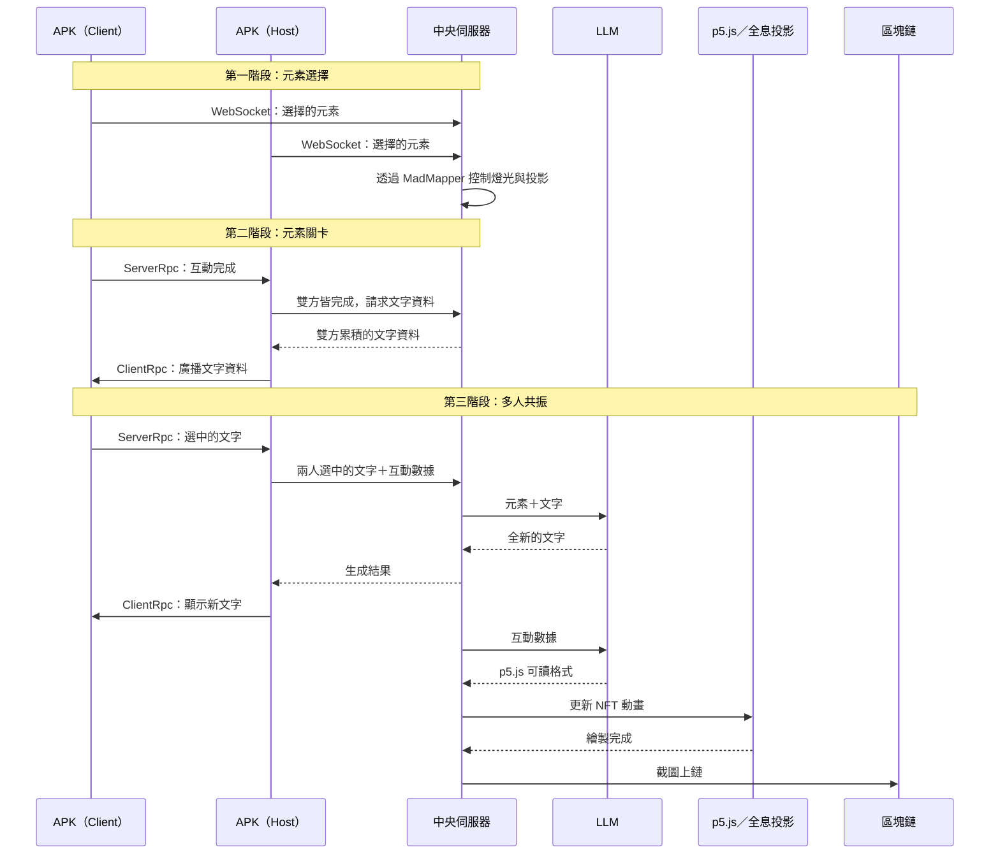
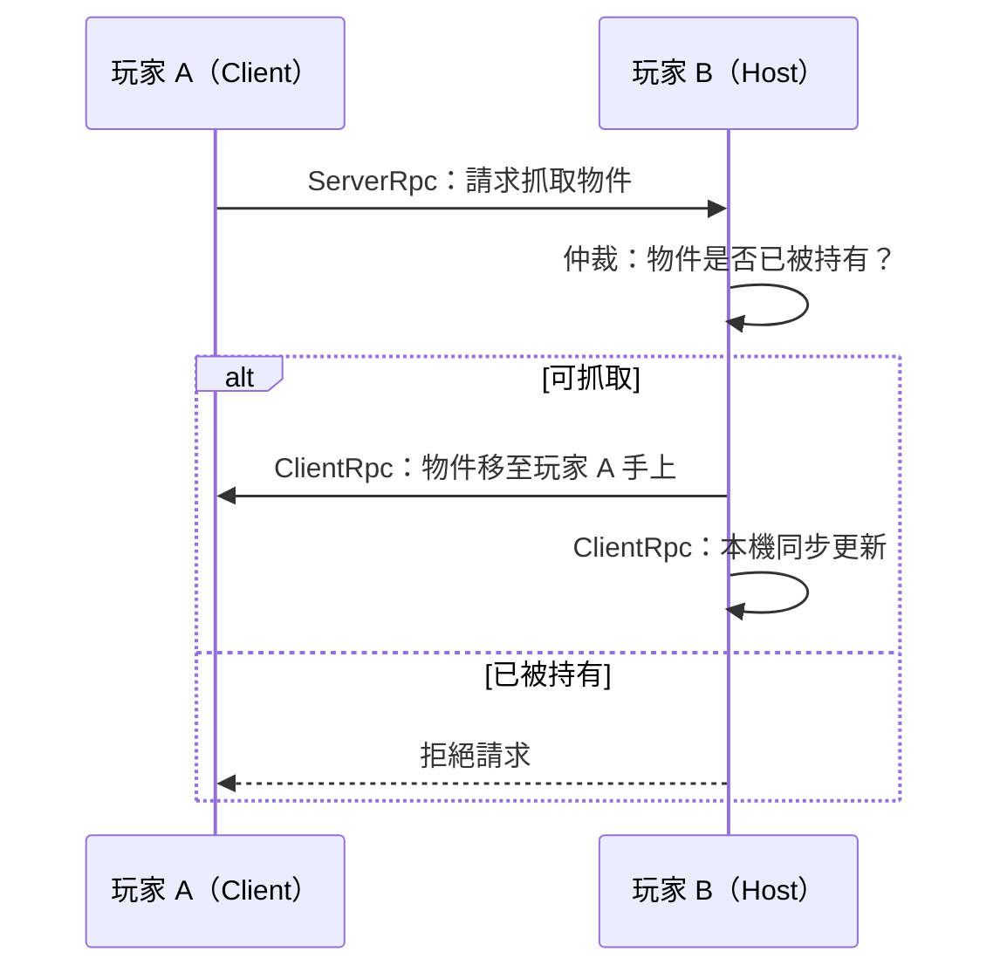

# 《Resonance・共振》

> 以「風、火、水、土」古希臘四元素所代表的個性為核心，由粒子共築而成的多人混合實境互動體驗。

初始是一片黑暗的虛空。隨著玩家的移動、觸碰與選擇，粒子開始在空間中生成。每個選擇都會留下軌跡：水的波紋、土的根基、風的流動、火的光芒……玩家不只是在體驗自己，也在過程中與他人交換痕跡，一起創造共振的世界。

---

## 目錄

- [體驗流程](#體驗流程)
- [系統架構](#系統架構)
- [模組說明](#模組說明)
- [互動流程詳解](#互動流程詳解)
- [多人同步機制（RPC）](#多人同步機制rpc)

---

## 體驗流程

| 階段 | 名稱 | 內容 |
| --- | --- | --- |
| 一 | 元素選擇 | 兩位玩家各自從四大元素中選擇一項。選擇結果決定第二階段的體驗內容，並同步投影出對應畫面、點亮對應顏色的燈條。 |
| 二 | 元素關卡 | 玩家進入所選元素的專屬關卡，系統即時偵測並記錄玩家的互動數據，供第三階段使用。 |
| 三 | 多人共振 | 前兩階段的場景消失，取而代之的是根據兩位玩家的選擇與互動所生成的文字。玩家可與文字互動（捏取、扔出等）；雙方各選定一個文字後，系統透過 LLM 生成全新的文字，並以 p5.js 繪製動畫呈現於全息投影設備，最後將圖樣上傳至區塊鏈。 |

---

## 系統架構

系統由五大模組組成：

1. **APK**：於兩台頭戴式裝置上運行的獨立應用程式（一台為 Host、一台為 Client）
2. **中央伺服器**：接收眼鏡端資料，負責燈光、投影、LLM 與 p5.js 的控制
3. **MadMapper**：接收伺服器指令，控制燈光與投影畫面
4. **燈光／投影／全息投影設備**：呈現對應的視覺特效
5. **NFT**：將 p5.js 繪製的圖樣上鏈

---

## 模組說明

### APK（頭戴式裝置）

兩台眼鏡的 APK 分別扮演 **Host** 與 **Client**。基於 Meta SDK 的多人連線架構，以遠端程序呼叫（RPC）維持各端點的狀態同步，詳見[多人同步機制](#多人同步機制rpc)。

### 中央伺服器

- 接收眼鏡端 APK 傳送的資料
- 控制燈光與投影（透過 MadMapper）
- 呼叫 LLM 生成文字，並將互動數據轉譯為 p5.js 可讀的格式
- 偵測 p5.js 圖樣繪製完成後截圖並上傳至區塊鏈

### MadMapper

接收伺服器指令，控制燈光與投影畫面。

### 燈光／投影／全息投影設備

接收來自伺服器的指令，呈現對應的特效。

### NFT

將 p5.js 繪製完成的圖樣上傳至區塊鏈。

---

## 互動流程詳解

### 第一階段：元素選擇

兩台 APK 選擇元素後，眼鏡端即時透過 **WebSocket** 將選擇結果傳給中央伺服器。伺服器收到資料後控制投影與燈光，改變展場的整體視覺。

### 第二階段：元素關卡

1. 先完成互動的一方進入 **pending** 狀態
2. 另一台眼鏡完成互動後，發送 `ServerRpc` 向 Host 提出請求
3. Host 確認雙方皆完成互動後，向中央伺服器發送請求
4. 伺服器將雙方累積的文字資料回傳給 Host
5. Host 透過 `ClientRpc` 將文字資料廣播至雙方眼鏡

### 第三階段：多人共振

1. 兩位玩家都點選文字後，Host 將兩人選中的文字與各自的互動數據送至中央伺服器
2. 伺服器以兩人的**元素**與**文字**作為輸入，呼叫 LLM 生成全新的文字
3. 生成結果回傳至 Host，再由 `ClientRpc` 同步顯示給兩位玩家
4. 同時，伺服器透過 LLM 將兩人的互動數據轉譯為 p5.js 可讀的格式，即時更新全息投影設備上的 NFT 動畫
5. 伺服器偵測到圖樣繪製完成後，截圖並上傳至區塊鏈，互動結束

---

## 多人同步機制（RPC）

在 Meta SDK 的多人連線架構中，遠端程序呼叫（RPC）是維持各端點狀態同步的核心機制。系統拓撲分為具備全域權威的**主機（Host）**與一般**客戶端（Client）**：

- **`ServerRpc`**：客戶端欲觸發影響場景狀態的事件時，須先向主機提出請求。主機接收後進行邏輯驗證與授權執行，以確保系統安全並防止非預期的客戶端操作。
- **`ClientRpc`**：主機處理並驗證完畢後，將狀態變更或行為指令廣播至所有已連線的客戶端（包含主機自身），讓全體同步渲染畫面或更新數值，確保所有連線者的體驗與資料保持一致。

### 範例：抓取同一個虛擬物件

假設玩家 A 為 Client、玩家 B 為 Host，兩人要與場景中的同一個物件互動：

1. 玩家 A 伸手抓取物件，但他的裝置**不會**直接在自己畫面上將物件拿走
2. 玩家 A 的程式先發送 `ServerRpc` 給玩家 B，提出「我想要抓取此物件」的請求
3. 玩家 B 的主機端負責仲裁，例如檢查該物件是否已被其他人拿著
4. 確認可以抓取後，主機發佈 `ClientRpc` 廣播給全場
5. 所有頭盔收到廣播後，物件才會同步移動到玩家 A 手上

透過這種「先請示、後廣播」的機制，可避免兩人同時搶奪同一物件時造成的畫面錯位與邏輯衝突。

